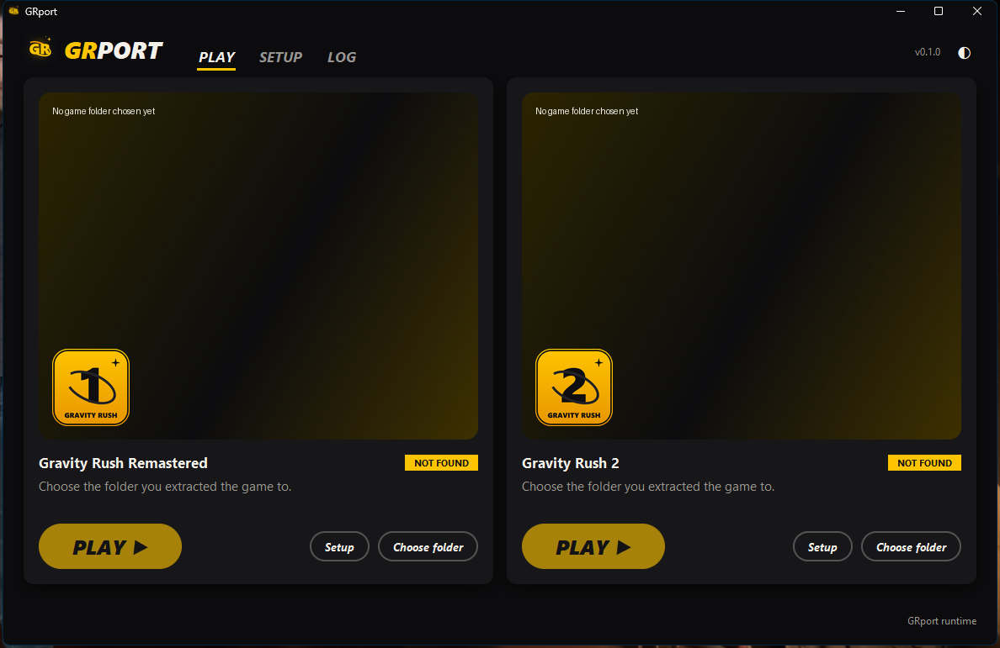
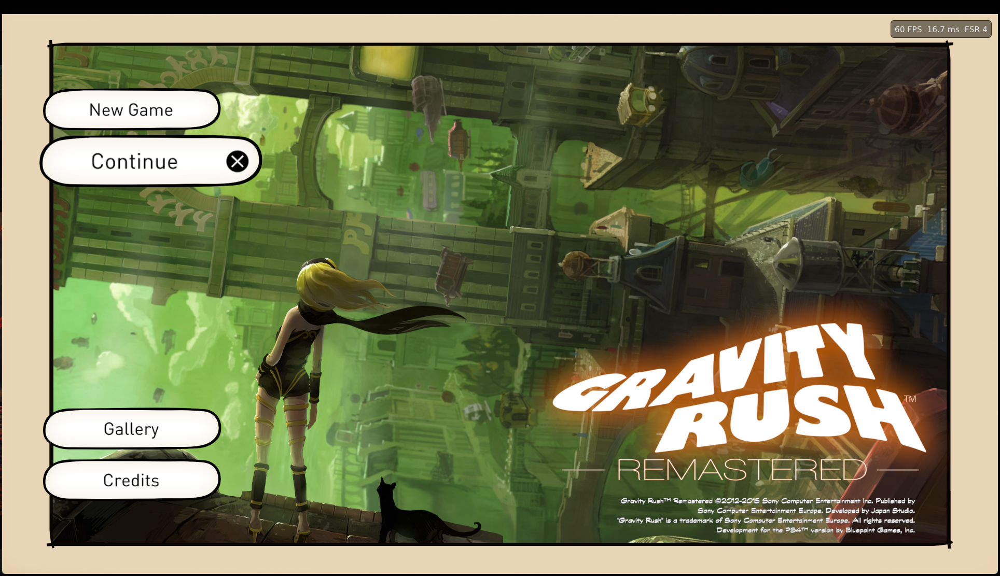
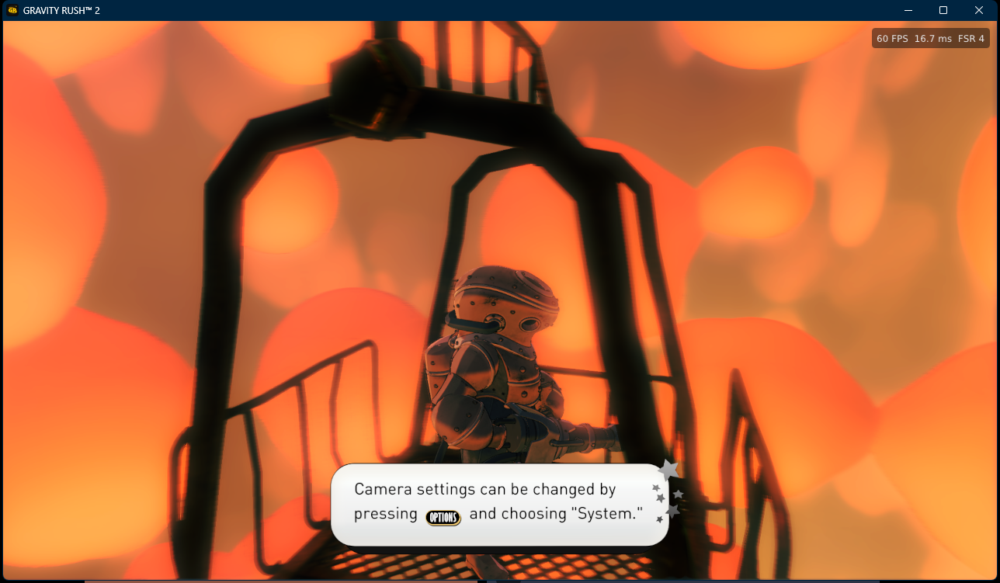

# GRport

Gravity Rush Remastered and Gravity Rush 2 on Windows (and, experimental, Linux), from one launcher.

GRport runs your own PS4 copies of the games natively on Windows: its own runtime, its own
audio, FSR 4 / DLSS anti-aliasing, Gravity Rush Remastered at up to 144 FPS and Gravity Rush 2
at up to 120 FPS.

| Gravity Rush Remastered | Gravity Rush 2 |
|---|---|
|  |  |

> **GRport is an unofficial, free fan project.** It is not affiliated with, endorsed by or
> sponsored by Sony Interactive Entertainment. "Gravity Rush", "PlayStation" and "PS4" are
> trademarks of their owners. **GRport contains no game files**: you need your own copy of the
> games, dumped from your own PS4 (or PS5: decrypted ELF dumps work too). Please don't ask for game files.

## Download

Get the latest release from the [Releases](../../releases) page:

- `GRport-<version>-windows.zip`: everything except FSR 4.
- `GRport-<version>-windows-fsr.zip`: the same plus FSR 4.

Unzip it anywhere (not inside Program Files), start `GRport.exe`, choose each game's dumped
folder (the one with `eboot.bin`) and press **PLAY**. The first PLAY prepares the game for
GRport (about a minute). Later versions install from the launcher: it checks GitHub when it
starts and the PLAY page offers a new version; your saves and settings stay.

### Linux and Steam Deck (experimental)

- `GRport-x86_64.AppImage`: the launcher, the runtime and Mesa's Vulkan drivers in one file
  (NVIDIA cards use the system's own NVIDIA driver).

Make it executable (`chmod +x GRport-x86_64.AppImage`, or Properties > Permissions) and start
it. On Steam Deck, add it to Steam as a non-Steam game to play from Game Mode. Saves, settings
and prepared games are in `~/.local/share/GRport`. A new version: download the new AppImage
when the launcher says one is out. The Linux build is new; if something doesn't work, please
open an issue with the LOG tab's **Copy for bug report**. The Windows build also runs through
Proton.

## Supported games

| Game | Tested | Also expected to work |
|---|---|---|
| Gravity Rush Remastered | Europe (CUSA01113), version 1.00 | USA (CUSA01130) |
| Gravity Rush 2 | USA (CUSA03694), version 1.11 | Europe, version 1.11 |

The launcher reads each copy's region from the game itself. Gravity Rush 2's frame rate patches
are for version 1.11; if they don't fit a copy, it plays at 30 FPS.

## Features

- **Native runtime**: no PS4 firmware or system files needed.
- **Sound**: GRport's own audio engine for the games' music, voices and effects.
- **Anti-aliasing**: FSR 3.1, FSR 4 (FSR edition), DLSS (NVIDIA RTX) or TAA, with sharpening;
  FSR 1 for screens above 1080p. Open GRport's menu in the game with **Insert** or **L3+R3**.
- **Gravity Rush Remastered at 60, 90, 120 or 144 FPS** and **Gravity Rush 2 at 60, 90 or
  120 FPS** (launcher SETUP), with Junmin Lee's frame rate patches and gravity kick camera fix,
  which the launcher downloads from his repository at the first PLAY.
- **Patches** (launcher SETUP), also by Junmin Lee: Gravity Rush 2 motion blur off, ambient
  occlusion trail fix, auto-exposure fix, skip intro, Cross confirms, cheats and unlocks;
  Gravity Rush Remastered skip intro.
- **Render and Aspect ratio** (launcher SETUP > Display, per game): the size the game draws at,
  no upscaling. Aspect ratio 4:3, 16:10, 16:9, 21:9 (2.39:1) or 32:9; Render picks a size of
  that shape, small to 4K (16:9: 1280x720, 1920x1080, 2560x1440, 3840x2160; 16:10: 1280x800 to
  3840x2400). Window size (Window mode) follows the same shape. Junmin Lee's resolution
  patches; the 4:3 sizes are made by GRport from his 16:10 patches. With anti-aliasing Off, 3840x2160
  is native 4K without any anti-aliasing. The FPS counter shows the size the game draws at.
- **Picture settings in the launcher** (SETUP > Picture, per game): anti-aliasing, sharpening,
  FSR 1, FPS counter, mute in background, the same as the in-game menu.
- **Controls** (launcher CONTROLS tab, per game): change any keyboard key or controller button.
- **Start a game directly**: `GRport.exe --gr1` or `GRport.exe --gr2` (for a shortcut or Steam);
  the launcher waits minimized and closes with the game.
- **Window**: Fullscreen (exclusive), Borderless (best for streaming / screen sharing) or
  Window.
- **Threading** (Auto, On, Off per game) and **desktop / Start menu shortcuts** (launcher
  SETUP).
- **Stick dead zone** (launcher SETUP, 0-40% per game, 10% by default) for controller sticks
  that drift.
- **PS4 Pro mode** (launcher SETUP, Gravity Rush 2, experimental, off by default): the game
  takes its own PS4 Pro render path.
- **Save slots**: Save and Load show a list of your saves to pick from (or a new one), and
  "Game saved" / "Game loaded" when done; Continue and Gallery; **language** of menus and
  subtitles; keyboard, mouse and controllers; FPS counter.
- **Trophies** (both games): earned trophies are kept per game and the game knows them after a
  restart; each unlock shows a card in the game with the trophy's icon, name and grade. The
  launcher's TROPHIES tab lists them all with their icons, earned dates and your progress. Local
  to your PC: they don't reach your PSN account.
- **Gravity Rush 2 photo album**: every photo is kept in `user/gr2/Capture Gallery`. SETUP >
  Camera Roll: **999 photos** (the game's own limit, the default) or **No limit**, where the
  in-game album shows the newest 500 so the camera keeps working past 999 (also in burst mode).
- **Updates from the launcher**: the update button downloads and installs the new version and
  shows its progress.

## Known problems

- Sound can stop after Alt+Tab.
- Tested so far: the openings and the early game of both games.
- DLSS has not been tested on an NVIDIA card yet.

If something goes wrong, use **LOG > Copy for bug report** in the launcher and open an issue.

## Source

- `launcher/`: the launcher (Python, Tkinter); `bash build.sh` builds `GRport.exe`.
- `prepare/`: the prepare step that links the game for the runtime (`gr-prepare.exe`).
- `linux/`: the Linux AppImage (Nix), built by `.github/workflows/linux.yml`.
- `runtime/`: the runtime's source, as a patch to the GPL runtime it is based on (see
  `runtime/README.md`).

## Support

GRport is free. If you'd like to support it: [ko-fi.com/qnfn1](https://ko-fi.com/qnfn1) ♥
More of my projects: [github.com/qnfn](https://github.com/qnfn)

## Credits

- The PS4 runtime by Supermedo and deadinside28 (bloodborne_pc) and the shadPS4 project, on
  which GRport's runtime is built (GPL); the Linux AppImage follows their Linux packaging.
- Junmin Lee: Gravity Rush 2 frame rate patches and crash fix (downloaded from his repository,
  not included).
- AMD FidelityFX (FSR), NVIDIA DLSS SDK, LibAtrac9 and the other libraries listed in the
  release's `licenses` folder.

## License

GPL-2.0-or-later (see [LICENSE](LICENSE)); bundled libraries keep their own licenses.
