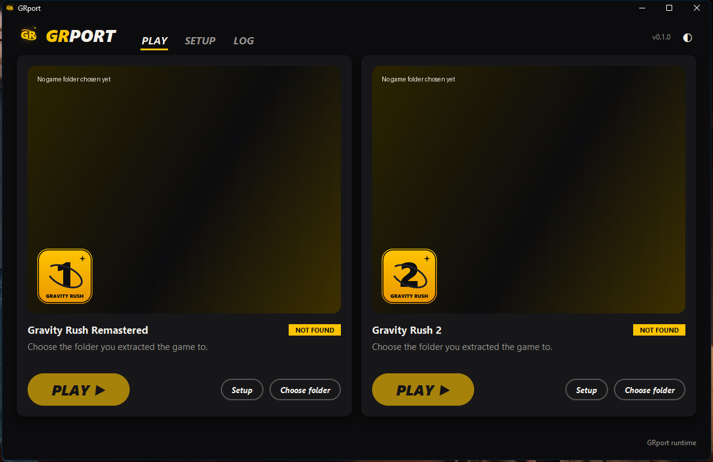
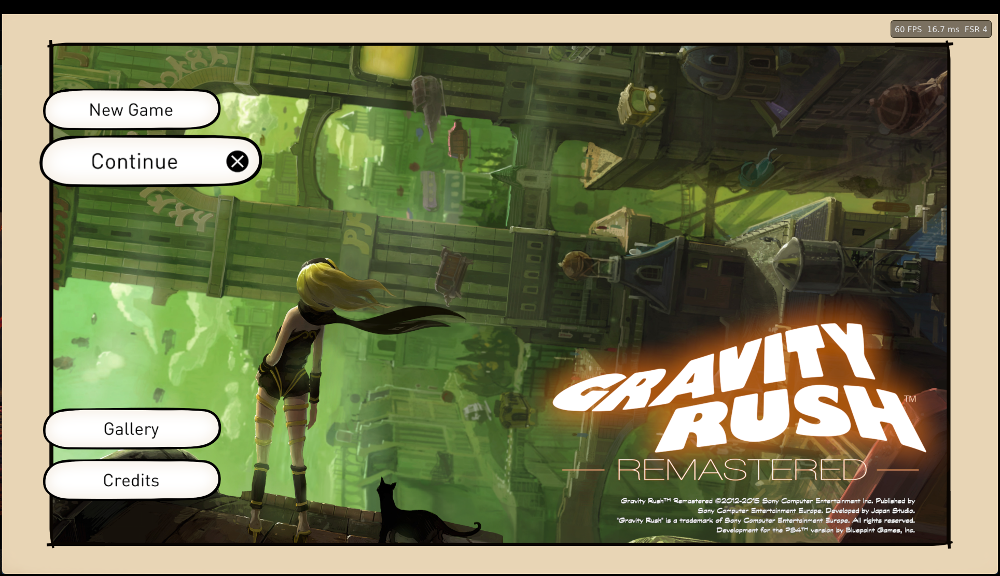
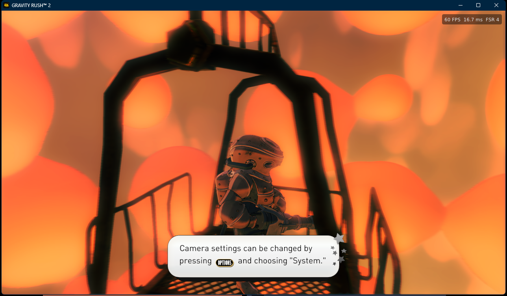

# GRport

Gravity Rush Remastered and Gravity Rush 2 on Windows, from one launcher.

GRport runs your own PS4 copies of the games natively on Windows: its own runtime, its own
audio, FSR 4 / DLSS anti-aliasing, Gravity Rush Remastered at up to 144 FPS and Gravity Rush 2
at up to 120 FPS.

| Gravity Rush Remastered | Gravity Rush 2 |
|---|---|
|  |  |

> **GRport is an unofficial, free fan project.** It is not affiliated with, endorsed by or
> sponsored by Sony Interactive Entertainment. "Gravity Rush", "PlayStation" and "PS4" are
> trademarks of their owners. **GRport contains no game files**: you need your own copy of the
> games, dumped from your own PS4. Please don't ask for game files.

## Download

Get the latest release from the [Releases](../../releases) page:

- `GRport-<version>-windows.zip`: everything except FSR 4.
- `GRport-<version>-windows-fsr.zip`: the same plus FSR 4.

Unzip it anywhere (not inside Program Files), start `GRport.exe`, choose each game's dumped
folder (the one with `eboot.bin`) and press **PLAY**. The first PLAY prepares the game for
GRport (about a minute). Later versions install from the launcher: **CHECK FOR UPDATES** (next
to LOG) finds them, and your saves and settings stay.

## Supported games

| Game | Tested | Also expected to work |
|---|---|---|
| Gravity Rush Remastered | Europe (CUSA01113), version 1.00 | USA (CUSA01130) |
| Gravity Rush 2 | USA (CUSA03694), version 1.11 | Europe, version 1.11 |

The launcher reads each copy's region from the game itself. Gravity Rush 2's frame rate patches
are for version 1.11; if they don't fit a copy, it plays at 30 FPS.

## Features

- **Native runtime**: no PS4 firmware or system files needed.
- **Sound**: GRport's own audio engine for the games' music, voices and effects.
- **Anti-aliasing**: FSR 3.1, FSR 4 (FSR edition), DLSS (NVIDIA RTX) or TAA, with sharpening;
  FSR 1 for screens above 1080p. Open GRport's menu in the game with **Insert** or **L3+R3**.
- **Gravity Rush Remastered at 60, 90, 120 or 144 FPS** and **Gravity Rush 2 at 60, 90 or
  120 FPS** (launcher SETUP), with Junmin Lee's frame rate patches and gravity kick camera fix,
  which the launcher downloads from his repository at the first PLAY.
- **Patches** (launcher SETUP), also by Junmin Lee: Gravity Rush 2 motion blur off, ambient
  occlusion trail fix, auto-exposure fix, skip intro, Cross confirms, cheats and unlocks;
  Gravity Rush Remastered skip intro.
- **Window**: Fullscreen (exclusive), Borderless (best for streaming / screen sharing) or
  Window.
- **Threading** (Auto, On, Off per game) and **desktop / Start menu shortcuts** (launcher
  SETUP).
- **Saves**, Continue and Gallery; **language** of menus and subtitles; keyboard, mouse and
  controllers; FPS counter.

## Known problems

- Sound can stop after Alt+Tab.
- Tested so far: the openings and the early game of both games.
- DLSS has not been tested on an NVIDIA card yet.

If something goes wrong, use **LOG > Copy for bug report** in the launcher and open an issue.

## Source

- `launcher/`: the launcher (Python, Tkinter); `bash build.sh` builds `GRport.exe`.
- `prepare/`: the prepare step that links the game for the runtime (`gr-prepare.exe`).
- `runtime/`: the runtime's source, as a patch to the GPL runtime it is based on (see
  `runtime/README.md`).

## Credits

- The Windows PS4 runtime by Supermedo and the shadPS4 project, on which GRport's runtime is
  built (GPL).
- Junmin Lee: Gravity Rush 2 frame rate patches and crash fix (downloaded from his repository,
  not included).
- AMD FidelityFX (FSR), NVIDIA DLSS SDK, LibAtrac9 and the other libraries listed in the
  release's `licenses` folder.

## License

GPL-2.0-or-later (see [LICENSE](LICENSE)); bundled libraries keep their own licenses.
